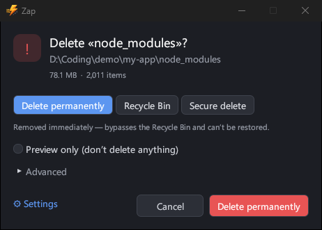

<p align="center">
  
</p>

<h1 align="center">Zap</h1>

<p align="center">
  Fast folder and file deletion for Windows, right from Explorer.
</p>

<p align="center">
  <a href="https://github.com/adxptived/zap/releases/latest"></a>
  <a href="https://github.com/adxptived/zap/actions/workflows/ci.yml"></a>
  <a href="LICENSE.txt"></a>
</p>

<p align="center">
  
</p>

Deleting `node_modules`, build output or a huge checkout with Explorer can take
minutes. Zap does it in seconds: it walks and deletes the tree in parallel and
removes each folder the moment it is empty. Right-click, confirm, done.

## Download

| File | |
| --- | --- |
| [`Zap-Setup.exe`](https://github.com/adxptived/zap/releases/latest/download/Zap-Setup.exe) | Installs Zap and adds it to the Explorer menu |
| [`Zap-Portable.zip`](https://github.com/adxptived/zap/releases/latest/download/Zap-Portable.zip) | The same programs, no installation |

Or from PowerShell:

```powershell
irm https://raw.githubusercontent.com/adxptived/zap/master/dist/install.ps1 | iex
```

The installer is per-user (no admin rights) and puts `zap` on your `PATH`.
The binaries are not code-signed yet, so Windows SmartScreen may ask once:
**More info → Run anyway**.

## Using it

Right-click files or folders in Explorer and open **Zap**:

| Menu item | What happens |
| --- | --- |
| **Delete with confirmation…** | Opens the dialog above: size, item count, and a choice of action |
| **Move to Recycle Bin** | Recycled immediately, restorable with Undo |
| **Quick delete (no confirmation)** | Deleted permanently and immediately; a message appears only if something fails |

Right-clicking the empty space of a folder offers **Delete current folder…**,
which always asks first.

In the dialog you can delete permanently, move to the Recycle Bin, or use
**Secure delete** (overwrite, then delete). **Preview only** shows what would
be removed without touching anything. You can also drop more files onto the
window, remove items before starting, pause or stop a run, and copy a failure
report. If something is locked by another program, **Retry as administrator**
retries just those items.

### Settings

Open **Zap Settings** from the Start menu, the dialog, or `zapg --settings`:

- language (system, English, Russian);
- the Explorer menu: submenu or flat, icons, which actions, Shift-only;
- the default action, auto-close after success, failure messages, worker threads;
- the operation journal — every run is logged to `%LOCALAPPDATA%\zap\journal.log`.

## Safety

Zap deletes for real, so it refuses what it should not touch:

- **Drive and share roots** (`C:\`, `\\server\share`) — always refused.
- **System folders** — `C:\Windows`, `Program Files`, `ProgramData` and
  everything inside them need an explicit extra confirmation.
- **Profile folders** — `C:\Users`, your profile and its Desktop, Documents,
  Downloads, AppData, OneDrive and other known folders (also when redirected
  to another drive) need it too; what is *inside* them stays deletable.
- **Links are never followed** — symlinks and junctions are removed as links,
  and the engine opens every folder relative to its parent, so a link swapped
  in mid-run cannot redirect it elsewhere.
- **The Recycle Bin never turns into permanent deletion** — anything the bin
  cannot take (too large, network drive) is skipped with an error.
- **Secure delete leaves hard links alone** — a file shared with other names
  is unlinked, not overwritten. On SSDs overwriting is best-effort.

## Command line

```text
zap [options] <path>...
```

Without `--yes` Zap shows what it is about to delete and asks first.

| Option | |
| --- | --- |
| `--yes` | Delete without asking |
| `--dry-run` | Show what would be deleted (files, folders, size), change nothing |
| `--recycle` | Move to the Recycle Bin |
| `--shred` | Overwrite files before deleting |
| `--only-empty` | Delete folders only if they are empty |
| `--include GLOB`, `--exclude GLOB` | Delete only matching / skip matching paths (repeatable) |
| `--min-size SIZE` | Only files of at least SIZE (`512k`, `10mb`, `1.5g`) |
| `--newer-than WHEN`, `--older-than WHEN` | By modification time: a date (`2026-01-01T00:00:00Z`) or an age (`12h`, `30d`) |
| `--threads N` | Number of worker threads |
| `--journal [N]` | Show the last N journal entries |
| `--no-journal` | Do not log this run |

```shell
zap --dry-run D:\projects\app\node_modules
zap --yes D:\projects\app\node_modules D:\projects\app\dist
zap --yes --exclude "*.log" D:\temp\build
zap --yes --older-than 30d D:\downloads\cache
```

`zap --help` lists everything. The command-line tool also builds and is
tested on Linux, where `/usr`, `/etc`, `/home`, your home folder and the like
are protected the same way.

## Building

Requirements: Rust (MSVC toolchain) and, for the installer, Inno Setup 6.

```shell
cargo build --release      # zap.exe, zapg.exe, zapw.exe in target\release
rebuild.bat                # optimized build + installer in dist\output
```

Before sending changes:

```shell
cargo fmt
cargo clippy --all-targets -- -D warnings
cargo test
```

Set `ZAP_SIGN_CERT_THUMBPRINT` to have `rebuild.ps1` sign the binaries and the
installer. Contributor notes and the module map are in [AGENTS.md](AGENTS.md);
the history is in [CHANGELOG.md](CHANGELOG.md).

## License

[Apache-2.0](LICENSE.txt)
